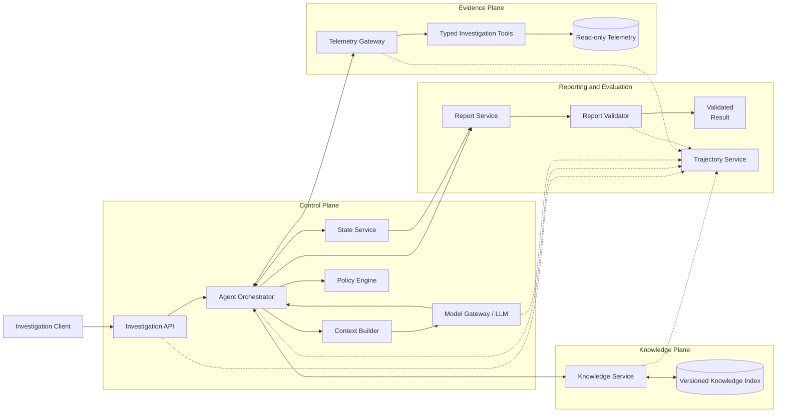

# Experimental Agent Architecture: C0-C7

**Full-agent architecture, condition-specific service activation, interfaces, data contracts, execution flows, safety controls, and observability**

Shared services, condition-specific service activation, interfaces, data
contracts, execution flow, safety controls, and observability

This document specifies the shared experimental execution platform and
the eight service configurations used in conditions C0-C7. C3 remains
the complete adaptive agent; the other conditions disable or replace
selected services to isolate parametric knowledge, external knowledge
retrieval, adaptive evidence acquisition, planning, and interpretation.

# 1. Scope and Design Goals

- Preserve causal interpretability by separating model policy, knowledge
  retrieval, evidence acquisition, state management, orchestration, and
  final synthesis.

- Expose observable, structured state rather than relying on
  unrestricted private chain-of-thought.

- Ensure all evidence is traceable to a specific action-observation pair
  and a stable evidence identifier.

- Keep the investigation environment read-only, bounded, and isolated.

- Record complete trajectories for counterfactual replay and trajectory
  surgery.

- Hold model family, decoding parameters, initial alert, and output
  schema fixed across experimental conditions wherever technically
  possible.

# 2. Architecture Overview


*Figure 1. C3 full-agent logical architecture. Solid arrows represent synchronous data or control flow; dashed arrows represent asynchronous trajectory recording.*

The system is divided into four planes: the agent control plane,
knowledge plane, evidence plane, and reporting/evaluation plane. The
control plane owns the investigation loop. The knowledge and evidence
planes expose bounded, typed interfaces. The reporting plane validates
the final result and stores the complete trajectory for causal analysis.

# 3. Service Inventory

| **Service**        | **Plane**            | **Primary responsibility**                                                                                |
|--------------------|----------------------|-----------------------------------------------------------------------------------------------------------|
| investigation-api  | External entry point | Accept requests, validate incident scope, create run IDs, return results.                                 |
| agent-orchestrator | Control plane        | Run the iterative investigation loop, route actions, enforce budgets, and handle retries.                 |
| context-builder    | Control plane        | Assemble bounded prompts from policy, alert, state, observations, and knowledge.                          |
| model-gateway      | Control plane        | Invoke the pinned LLM, require structured output, and account for tokens and latency.                     |
| state-service      | Control plane        | Persist hypotheses, confidence, evidence ledger, entities, timeline, and stopping state.                  |
| policy-engine      | Safety plane         | Validate actions, enforce read-only scope, normalize arguments, and reject unsafe requests.               |
| knowledge-service  | Knowledge plane      | Retrieve versioned ATT&CK, Sigma, detection, and playbook passages.                                       |
| telemetry-gateway  | Evidence plane       | Expose typed investigation tools, normalize observations, and assign stable evidence IDs.                 |
| telemetry-store    | Evidence plane       | Provide read-only incident telemetry from endpoint, identity, network, file, registry, and cloud sources. |
| report-service     | Output plane         | Generate the final structured incident report from the final investigation state.                         |
| report-validator   | Output plane         | Validate schema, evidence references, ATT&CK identifiers, and unsupported claims.                         |
| trajectory-service | Evaluation plane     | Store immutable step records and replay checkpoints for causal interventions.                             |
| metrics-service    | Evaluation plane     | Compute outcome, evidence, trajectory, efficiency, reliability, and causal metrics.                       |

# 4. Detailed Service Descriptions

## 4.1 Investigation API

Receives an investigation request, validates the incident and
experimental condition, creates a run identifier, initializes budgets,
and returns a validated result. It does not contain reasoning logic.

**Primary interface:** POST /v1/investigations; GET
/v1/investigations/{run_id}; GET /v1/investigations/{run_id}/trajectory

## 4.2 Agent Orchestrator

Owns the control loop. It initializes state, requests a model decision,
validates the selected action, invokes knowledge or telemetry services,
records observations, updates budget counters, and terminates on a valid
stop decision or hard limit.

**Primary interface:** Internal RPC: StartRun, NextStep, ExecuteAction,
StopRun

## 4.3 Context Builder

Constructs the model input from six layers: system policy, incident
context, tool schemas, structured state, recent observations, and
retrieved knowledge. It performs deduplication, truncation accounting,
and token-budget allocation.

**Primary interface:** Internal RPC: BuildContext(ContextBuildRequest)
-\> ModelContext

## 4.4 Model Gateway

Pins model name, model version, decoding parameters, and
structured-output schema. It returns either an AgentDecision or a typed
ModelError. The model never receives direct datastore credentials.

**Primary interface:** Internal RPC: GenerateDecision(ModelContext) -\>
AgentDecision

## 4.5 State Service

Maintains the observable investigation state. It stores competing
hypotheses, confidence, known and contradicting evidence, unresolved
questions, action history, entity memory, timeline state, knowledge
references, budgets, and stopping rationale.

**Primary interface:** Internal RPC: CreateState, GetState,
ApplyStatePatch, CreateCheckpoint

## 4.6 Policy Engine

Enforces tool allowlists, incident scoping, read-only execution, maximum
time ranges, result limits, query syntax constraints, evidence-grounding
rules, and prompt-injection handling.

**Primary interface:** Internal RPC: ValidateAction(ActionRequest) -\>
PolicyDecision

## 4.7 Knowledge Service

Retrieves versioned passages from ATT&CK, Sigma metadata, detection
guidance, and investigation playbooks. It distinguishes declarative,
detection-oriented, and procedural knowledge.

**Primary interface:** POST /internal/knowledge/search

## 4.8 Telemetry Gateway

Provides typed, read-only investigation tools. It validates arguments,
enforces limits, queries the telemetry store, normalizes records, and
assigns stable evidence identifiers.

**Primary interface:** POST /internal/tools/{tool_name}

## 4.9 Telemetry Store

Stores incident data and exposes only scoped, read-only query adapters.
Ground-truth labels are physically or logically separated from
agent-accessible telemetry.

**Primary interface:** Internal adapters for process, identity, network,
file, registry, and cloud audit data.

## 4.10 Report Service

Transforms the final state into the required report schema. It may
perform one constrained repair pass if deterministic validation fails,
but it cannot introduce new evidence.

**Primary interface:** POST /internal/reports/generate

## 4.11 Report Validator

Performs deterministic checks: schema completeness, verdict vocabulary,
confidence bounds, evidence-ID existence, ATT&CK syntax, citation
coverage, and unsupported-claim detection.

**Primary interface:** POST /internal/reports/validate

## 4.12 Trajectory Service

Stores append-only execution events and state checkpoints. It supports
replay from a selected step with a replaced plan, query, observation,
knowledge passage, state, stopping decision, or synthesis step.

**Primary interface:** POST /internal/trajectory/events; POST
/internal/replay

## 4.13 Metrics Service

Computes incident accuracy, macro-F1, evidence precision/recall,
unsupported-claim rate, useful-query rate, adaptive dependency,
belief-update score, CRG, evidence dependence, cost, latency, and
calibration.

**Primary interface:** POST /internal/metrics/evaluate

# 5. End-to-End Execution Flow

| **Step** | **Stage**                    | **Description**                                                                                                         |
|----------|------------------------------|-------------------------------------------------------------------------------------------------------------------------|
| 1        | Create run                   | API validates the request and creates run_id, incident scope, C3 configuration, and execution budgets.                  |
| 2        | Initialize state             | State service creates s0 from the initial alert only. No telemetry or knowledge is preloaded.                           |
| 3        | Build context                | Context builder assembles policy, alert, state, tool schemas, and recent observations.                                  |
| 4        | Generate decision            | Model gateway returns hypotheses, confidence, next question, selected action, expected discrimination, and stop fields. |
| 5        | Validate action              | Policy engine allows, normalizes, or rejects the selected action.                                                       |
| 6        | Execute action               | Orchestrator invokes either retrieve_knowledge or a telemetry tool through the appropriate gateway.                     |
| 7        | Record observation           | Trajectory service stores the action, arguments, returned content, latency, and provenance.                             |
| 8        | Update state                 | State service applies an explicit patch and records confidence changes and evidence references.                         |
| 9        | Repeat or stop               | The loop continues while the stop flag is false and budgets remain.                                                     |
| 10       | Generate and validate report | Report service emits the final schema; validator checks grounding and consistency.                                      |
| 11       | Finalize trajectory          | Trajectory service stores the report, validator outcome, and replay checkpoint metadata.                                |

# 6. Service Interfaces and Data Schemas

## 6.1 Investigation Request

**JSON schema example**

```json
{

"incident_id": "incident-0042",

"condition": "C3",

"initial_alert": {

"timestamp": "2026-07-10T14:23:11Z",

"host": "workstation-17",

"user": "analyst-user",

"alert_type": "suspicious_powershell",

"summary": "Encoded PowerShell execution detected"

},

"scope": {

"allowed_log_sources": [

"process_events",

"powershell",

"network"

],

"start": "2026-07-10T14:00:00Z",

"end": "2026-07-10T15:00:00Z"

},

"budgets": {

"max_tool_calls": 12,

"max_records_per_call": 100,

"max_runtime_seconds": 300,

"max_model_tokens": 32000

}

}
```
## 6.2 Agent Decision

```json
{

"schema_version": "1.0",

"hypotheses": [

{

"hypothesis_id": "h1",

"claim": "The alert represents malicious execution.",

"confidence": 0.68

},

{

"hypothesis_id": "h2",

"claim": "The activity is approved administration.",

"confidence": 0.32

}

],

"known_evidence": [

"event-1021"

],

"contradicting_evidence": [],

"next_question": "Was the process launched by an approved management
application?",

"selected_action": {

"action_id": "a-003",

"tool": "find_process_tree",

"arguments": {

"host": "workstation-17",

"process_or_event_id": "event-1021"

}

},

"expected_discrimination": "The parent process distinguishes approved
administration from interactive malicious execution.",

"stop": false,

"stop_reason": ""

}
```
## 6.3 Investigation State

```json
{

"run_id": "run-8f31",

"step": 3,

"hypotheses": [],

"known_evidence": [],

"contradicting_evidence": [],

"unresolved_questions": [],

"entities": {

"hosts": [],

"users": [],

"ips": [],

"files": [],

"processes": []

},

"timeline": [],

"knowledge_references": [],

"action_history": [],

"budget_state": {

"tool_calls_used": 2,

"tool_calls_remaining": 10,

"runtime_ms": 18400,

"model_tokens_used": 7210

},

"stop_state": {

"stop": false,

"reason": ""

},

"state_version": 4

}
```
## 6.4 Policy Decision

```json
{

"action_id": "a-003",

"decision": "allow",

"reason": "Tool and arguments are permitted within incident scope.",

"normalized_action": {

"tool": "find_process_tree",

"arguments": {

"host": "workstation-17",

"process_or_event_id": "event-1021",

"max_depth": 4

}

},

"applied_limits": {

"max_records": 100,

"timeout_ms": 5000

}

}
```
## 6.5 Knowledge Search Request and Response

```json
{

"request": {

"question": "What telemetry distinguishes malicious encoded PowerShell
from approved administration?",

"corpus_tags": [

"detection",

"procedural",

"powershell"

],

"top_k": 4

},

"response": {

"passages": [

{

"passage_id": "kbp-1881",

"source_id": "attack-T1059.001-v15",

"source_version": "15.1",

"category": "detection",

"text": "Examine parent process, command line, user context, and
subsequent network or persistence activity.",

"score": 0.88

}

],

"index_version": "kb-2026-07"

}

}
```
## 6.6 Tool Request Envelope

```json
{

"run_id": "run-8f31",

"action_id": "a-004",

"tool": "query_events",

"arguments": {

"source": "process_events",

"filter": {

"host": "workstation-17",

"process_name": "powershell.exe"

},

"group_by": [

"parent_process_name"

],

"order": "timestamp_ascending",

"limit": 100

},

"scope_token": "opaque-scope-reference"

}
```
## 6.7 Tool Observation Envelope

```json
{

"run_id": "run-8f31",

"action_id": "a-004",

"tool": "query_events",

"status": "success",

"records": [

{

"evidence_id": "event-1021",

"source": "process_events",

"timestamp": "2026-07-10T14:23:11Z",

"host": "workstation-17",

"fields": {

"process_name": "powershell.exe",

"parent_process_name": "winword.exe"

}

}

],

"record_count": 1,

"truncated": false,

"execution_time_ms": 37,

"schema_version": "1.0",

"provenance": {

"dataset": "incident-0042",

"source_partition": "process_events"

}

}
```
## 6.8 Final Report

```json
{

"verdict": "malicious",

"confidence": 0.93,

"summary": "The encoded PowerShell execution was followed by
suspicious network and persistence activity.",

"attack_chain": [

{

"stage": "Execution",

"technique": "T1059.001",

"evidence_ids": [

"event-1021",

"event-1024"

]

}

],

"key_entities": {

"hosts": [

"workstation-17"

],

"users": [

"analyst-user"

],

"ips": [

"203.0.113.18"

],

"files": [

"update.ps1"

]

},

"supporting_evidence": [

{

"event_id": "event-1021",

"claim": "PowerShell was launched with an encoded command."

}

],

"contradicting_evidence": [],

"remaining_uncertainty": "The initial delivery mechanism was not
observed.",

"recommended_human_check": "Confirm whether the destination IP belongs
to approved infrastructure."

}
```
## 6.9 Trajectory Event

```json
{

"event_id": "traj-0004",

"run_id": "run-8f31",

"step": 4,

"event_type": "tool_observation",

"timestamp": "2026-07-10T14:24:02.384Z",

"parent_state_version": 4,

"action": {

"tool": "query_events",

"arguments_hash": "sha256:..."

},

"observation_ref": "obs-004",

"evidence_ids": [

"event-1021"

],

"model_metadata": {

"model": "pinned-model-version",

"temperature": 0.2,

"seed": 42

},

"replay_checkpoint": true

}
```
# 7. Tool Interface Catalog

| **Tool**           | **Inputs**                           | **Outputs**                                    | **Capability tested**         |
|--------------------|--------------------------------------|------------------------------------------------|-------------------------------|
| grep_logs          | pattern, source, time_range, limit   | Matching raw records with stable evidence IDs  | Lexical evidence search       |
| query_events       | filter, group_by, order, limit       | Structured rows and aggregates                 | Query planning and schema use |
| find_process_tree  | host, process_or_event_id, max_depth | Parent/child process graph                     | Entity pivoting               |
| build_timeline     | entities, time_range, sources, limit | Ordered cross-source events                    | Temporal synthesis            |
| search_related     | entity, relation, time_range, limit  | Related hosts, users, IPs, files, or processes | Multi-hop investigation       |
| retrieve_knowledge | question, corpus_tags, top_k         | Versioned KB passages                          | External knowledge use        |
| submit_report      | final report object                  | Validated final schema                         | Grounded synthesis            |

# 8. Data Integrity and State Invariants

- Every factual incident claim must cite at least one stable evidence
  ID.

- Every evidence ID must originate from a recorded tool observation in
  the same run.

- Knowledge passages are guidance or prior information; they are never
  treated as proof that an event occurred.

- Confidence values are bounded to \[0,1\], and every update records the
  previous and new value.

- Contradicting evidence cannot be removed without an explicit state
  patch and recorded rationale.

- Ground-truth labels are inaccessible to the agent, context builder,
  model gateway, knowledge service, and telemetry gateway.

- Truncation, summarization, filtering, and result caps are recorded in
  trajectory metadata.

- A report cannot cite evidence removed by a counterfactual
  intervention.

# 9. Safety and Security Controls

| **Control**                 | **Requirement**                                                                           |
|-----------------------------|-------------------------------------------------------------------------------------------|
| Read-only execution         | No write, response, containment, or account-modification actions are available.           |
| Tool allowlist              | Only the seven declared interfaces can be invoked.                                        |
| Scope enforcement           | Every query is restricted to the current incident, time range, and permitted log sources. |
| Prompt-injection resistance | Telemetry and documents are delimited and treated as untrusted data, never instructions.  |
| Result bounding             | Maximum records, output bytes, query duration, and tool-call budgets are enforced.        |
| No unrestricted network     | The agent cannot browse arbitrary external systems or exfiltrate data.                    |
| Citation enforcement        | Final factual claims require stable evidence IDs.                                         |
| Human verification          | The output is an experimental investigation report, not an autonomous response decision.  |

# 10. Observability and Reproducibility

- Pin and record model name, version, access date, decoding parameters,
  seed, and output schema version.

- Record every tool request, normalized request, response, error,
  latency, and truncation indicator.

- Version the KB index, chunking policy, embedding model, source corpus,
  and retrieval depth.

- Store state checkpoints before and after each action.

- Emit distributed trace IDs linking API, model, knowledge, telemetry,
  validation, and trajectory events.

- Record token use, tool calls, records returned, wall-clock time, and
  monetary cost per incident.

- Preserve replay metadata sufficient to rerun downstream execution from
  any intervention point.

# 11. Counterfactual Replay Interface

The replay service reconstructs a trajectory prefix, applies one
semantically meaningful intervention, and reruns downstream execution
without exposing the original final answer.

```json
{

"source_run_id": "run-8f31",

"intervention": {

"type": "query_repair",

"step": 4,

"replacement": {

"tool": "query_events",

"arguments": {

"source": "process_events",

"filter": {

"host": "workstation-17",

"parent_process_name": "winword.exe"

},

"limit": 100

}

}

},

"replay": {

"repetitions": 20,

"paired_seeds": true,

"preserve_prefix": true,

"hide_original_final_answer": true

}

}
```
Supported intervention types: plan_repair, query_repair,
knowledge_ablation, observation_swap, evidence_ablation, state_repair,
stop_repair, and synthesis_repair.

# 12. Deployment and Implementation Guidance

For a research prototype, the logical services may run in a single
process while preserving typed boundaries and independent logs. For
scaled evaluation, the model gateway, knowledge service, telemetry
gateway, trajectory service, and metrics service are natural independent
deployments. Synchronous request-response interfaces are appropriate for
agent steps; trajectory recording and metrics aggregation should be
asynchronous and append-only.

| **Deployment unit**                   | **Recommendation**                                                                    |
|---------------------------------------|---------------------------------------------------------------------------------------|
| API/orchestrator/state/context/policy | Single control-plane deployment for low-latency step execution.                       |
| Model gateway                         | Independent deployment to pin provider/model configuration and centralize accounting. |
| Knowledge service                     | Independent deployment with immutable index versions.                                 |
| Telemetry gateway                     | Independent restricted service with dataset-specific adapters.                        |
| Trajectory service                    | Append-only storage with checkpoint and replay support.                               |
| Metrics service                       | Offline or asynchronous batch computation.                                            |

# 13. Acceptance Criteria

| **Area**              | **Acceptance criterion**                                                                                                              |
|-----------------------|---------------------------------------------------------------------------------------------------------------------------------------|
| Interface correctness | All requests and responses validate against versioned schemas.                                                                        |
| Evidence traceability | Every cited event is linked to one recorded observation and source provenance.                                                        |
| Isolation             | No tool can perform a write or access data outside the incident scope.                                                                |
| State reproducibility | Replaying the same prefix with a pinned model and supported seed reproduces the checkpoint state within documented stochastic limits. |
| Replay support        | Every semantic intervention can be applied without exposing the original final answer.                                                |
| Observability         | A single trace ID reconstructs the complete run across all services.                                                                  |
| Condition fidelity    | C3 enables both knowledge retrieval and adaptive search, with no oracle evidence or oracle plan.                                      |

# Appendix A. Mermaid Architecture Source


Source basis: the manuscript defines C3 as the full agent with
knowledge-base access and adaptive search, specifies typed read-only
tools, a compact observable state, and trajectory recording for causal
replay. This architecture expands those requirements into deployable
services and versioned contracts.

# 14. Experimental Testing Setup Across C0-C7

The experimental harness runs every condition through a common control
plane while changing the availability and authority of knowledge,
search, planning, state, and evidence-provider services. A disabled
service must be inaccessible at the interface level; prompt instructions
alone are not considered sufficient isolation.


*Figure 2. Shared test architecture and condition-specific service profiles.* The condition controller instantiates a reproducible service
graph before each run.

## 14.1 Service Activation Matrix

Legend: On = available to the condition; Off = interface unavailable;
Fixed = deterministic system-controlled execution; Passive = content
supplied as context without agent control; Oracle = expert-provided
component.

| Service / capability            | C0  | C1  | C2    | C3    | C4    | C5      | C6     | C7     |
|---------------------------------|-----|-----|-------|-------|-------|---------|--------|--------|
| Raw-context assembler           | On  | On  | Alert | Alert | Alert | Alert   | Alert  | Alert  |
| Knowledge service               | Off | On  | Off   | On    | On    | On      | On     | On     |
| Adaptive agent loop             | Off | Off | On    | On    | Off   | Off     | Off    | On     |
| Structured hypothesis state     | Off | Off | On    | On    | Off   | Off     | Off    | On     |
| Telemetry tool gateway          | Off | Off | On    | On    | Fixed | Off     | Off    | On     |
| Fixed-retrieval executor        | Off | Off | Off   | Off   | On    | Off     | Off    | Off    |
| Matched-evidence constructor    | Off | Off | Off   | Off   | Off   | Passive | Off    | Off    |
| Oracle-evidence provider        | Off | Off | Off   | Off   | Off   | Off     | Oracle | Off    |
| Oracle-plan provider            | Off | Off | Off   | Off   | Off   | Off     | Off    | Oracle |
| Report service and validator    | On  | On  | On    | On    | On    | On      | On     | On     |
| Trajectory recorder and metrics | On  | On  | On    | On    | On    | On      | On     | On     |

## 14.2 Condition Service Graphs

### C0 Raw LLM

Only the raw-context assembler, model gateway, report validator,
trajectory recorder, and metrics service are active. The knowledge and
telemetry interfaces are not registered. The model receives one fixed
raw-log context window and produces one report.

### C1 Knowledge-only

C0 plus the knowledge service. The model may receive versioned ATT&CK,
Sigma, detection, or playbook passages, but no telemetry search
interface is exposed. The raw telemetry context is identical to C0.

### C2 Search-only agent

The adaptive orchestrator, state service, policy engine, telemetry
gateway, and read-only tools are active. The knowledge service is
absent. The agent must discover evidence from telemetry using
observations and structured hypothesis updates.

### C3 Full agent

All core agent services are active: adaptive orchestration, structured
state, knowledge retrieval, telemetry search, policy enforcement,
reporting, validation, and complete trajectory recording.

### C4 Fixed retrieval

The adaptive agent loop and state service are disabled. A deterministic
executor runs analyst-designed telemetry queries and knowledge retrieval
before model inference. The model interprets the resulting passive
context but cannot choose or revise queries.

### C5 Passive matched evidence

The telemetry gateway and adaptive loop are disabled. A matched-evidence
constructor loads the exact telemetry records returned by the
corresponding C3 run, removes tool names and search order, reorders the
records, and supplies them as passive context together with knowledge
passages. C5 therefore depends on a completed matched C3 trajectory.

### C6 Oracle evidence

Search and adaptive state are disabled. An oracle-evidence provider
supplies the expert-minimal decisive telemetry set, plus the enabled
knowledge context. This condition estimates the upper bound on
interpretation when evidence selection is perfect.

### C7 Oracle plan

The oracle-plan provider supplies an expert investigation plan. The
adaptive loop, state service, knowledge service, telemetry gateway, and
read-only tools remain active. The agent executes the plan and may adapt
tool arguments and beliefs, isolating the planning bottleneck.

## 14.3 Condition Configuration Interface

The condition controller should materialize the following configuration
before creating a run. Service discovery and authorization are generated
from this object so that disabled interfaces cannot be called.

```json
{

"condition_id": "C3",

"model_profile": "primary-model-v1",

"context_mode": "alert_only \| fixed_raw \| passive_matched \|
oracle_evidence",

"knowledge": {

"enabled": true,

"retrieval_mode": "agent_selected \| fixed \| passive",

"top_k": 4

},

"search": {

"enabled": true,

"control_mode": "adaptive_agent \| fixed_executor \| disabled",

"tool_allowlist": [

"grep_logs",

"query_events",

"find_process_tree",

"build_timeline",

"search_related"

]

},

"state": {

"enabled": true,

"schema_version": "1.0"

},

"oracle": {

"plan_provider": false,

"evidence_provider": false

},

"matched_run": {

"required": false,

"source_condition": null,

"source_run_id": null

},

"budgets": {

"maximum_tool_calls": 12,

"maximum_records_per_call": 100,

"maximum_runtime_seconds": 300

}

}
```
## 14.4 Condition Profile Values

| Condition | context_mode          | knowledge         | search control | state | special provider / dependency |
|-----------|-----------------------|-------------------|----------------|-------|-------------------------------|
| C0        | fixed_raw             | off               | disabled       | off   | none                          |
| C1        | fixed_raw             | agent-selected KB | disabled       | off   | none                          |
| C2        | alert_only            | off               | adaptive_agent | on    | none                          |
| C3        | alert_only            | agent-selected KB | adaptive_agent | on    | none                          |
| C4        | passive fixed results | fixed KB          | fixed_executor | off   | analyst query pack            |
| C5        | passive_matched       | passive KB        | disabled       | off   | matched C3 run required       |
| C6        | oracle_evidence       | passive KB        | disabled       | off   | oracle evidence pack          |
| C7        | alert_only            | agent-selected KB | adaptive_agent | on    | oracle plan pack              |

## 14.5 Test Harness Execution Rules

- Resolve the incident and freeze the model profile, decoding
  parameters, output schema, budget, knowledge index version, and tool
  schema version.

- Instantiate only the services permitted by the selected condition
  profile. Calls to disabled services must fail with SERVICE_DISABLED
  before any model or environment interaction occurs.

- Record a service-manifest hash in the trajectory so each run can be
  audited and reproduced.

- For C5, require a completed C3 source run with at least one retrieved
  evidence record. Zero-evidence C3 runs are reported separately and are
  not silently backfilled.

- For C4, execute the analyst query pack deterministically and store the
  query-pack version and returned evidence IDs.

- For C6 and C7, store oracle artifact identifiers, authorship, review
  status, and minimality-review metadata.

- Use the same final-report schema and deterministic validator for every
  condition.

- Emit both outcome metrics and process-availability metadata so metrics
  that are undefined for non-agent conditions are reported as not
  applicable rather than zero.

## 14.6 Service Manifest and Run Metadata Schema

```json
{

"run_id": "run-uuid",

"incident_id": "incident-0042",

"condition_id": "C5",

"service_manifest": {

"investigation_api": "1.2.0",

"condition_controller": "1.0.0",

"model_gateway": "2.1.0",

"knowledge_service": "1.4.2",

"agent_orchestrator": null,

"state_service": null,

"telemetry_gateway": null,

"matched_evidence_constructor": "1.1.0",

"report_validator": "1.3.0",

"trajectory_recorder": "1.5.0"

},

"service_manifest_hash": "sha256:...",

"source_run": {

"condition_id": "C3",

"run_id": "matched-c3-run-uuid"

},

"artifact_versions": {

"prompt": "c5-v3",

"output_schema": "report-1.0",

"knowledge_index": "kb-2026-07-01",

"tool_schema": "tools-1.0"

}

}
```
## 14.7 Interface Availability Errors

Every disabled interface returns a deterministic error envelope. This
prevents a condition from accidentally gaining capability through a
hidden fallback or permissive routing layer.

```json
{

"status": "error",

"error_code": "SERVICE_DISABLED",

"condition_id": "C1",

"service": "telemetry_gateway",

"operation": "query_events",

"message": "Telemetry search is disabled for condition C1.",

"retryable": false

}
```
## 14.8 Metric Applicability by Condition

Outcome and evidence metrics apply to all conditions.
Adaptive-dependency, belief-update, stopping, and query-utility metrics
apply only when the corresponding services are active. Fixed-query
efficiency applies to C4, while plan-adherence and planning-bottleneck
metrics apply to C7. Causal replay records must preserve the original
service profile unless the intervention explicitly changes a component.

Source basis: the manuscript defines the C0-C7 condition matrix, the
constrained read-only tool set, the observable structured state, context
controls for C5, and the oracle conditions. This section translates
those experimental definitions into enforceable service-level
configurations and test-harness contracts.
